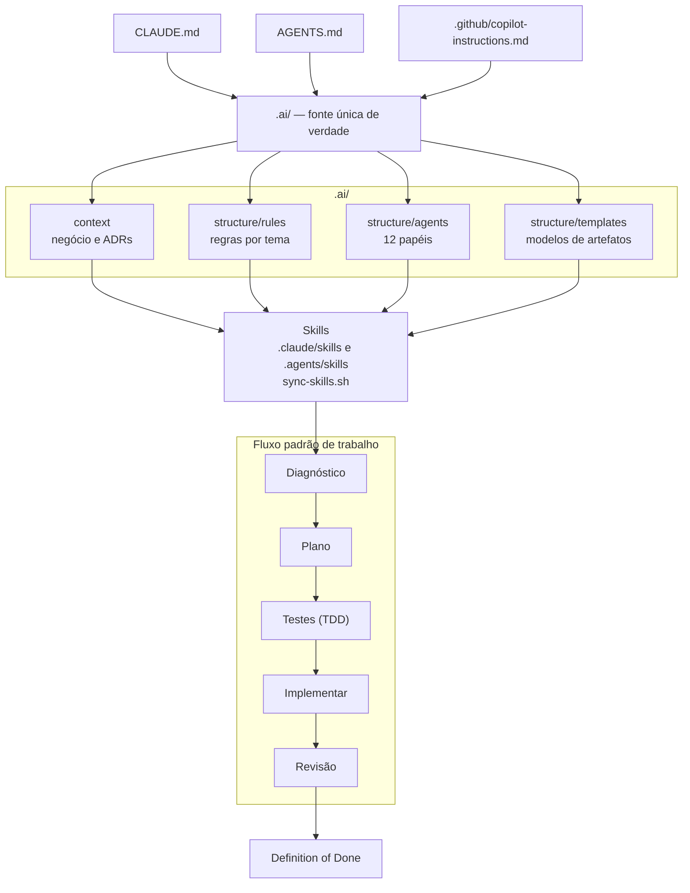

# AI Engineering Monorepo

Template de governança para desenvolvimento assistido por IA com **Claude Code**, **OpenAI Codex** e **GitHub Copilot** no mesmo
monorepo: agentes, regras, templates, skills, catálogo de stacks e validador, prontos para Spring Boot ou NestJS, Ionic Angular
ou Angular, MongoDB, Docker e GitHub Actions.

`#claude-code` `#codex` `#github-copilot` `#ai-agents` `#agent-skills` `#agents-md` `#ai-coding` `#ai-governance`
`#prompt-engineering` `#template` `#monorepo` `#spring-boot` `#nestjs` `#ionic` `#angular` `#mongodb` `#ddd`
`#clean-architecture` `#tdd` `#microservices` `#docker` `#github-actions` `#devops` `#adr`

## Objetivo

Este repositório centraliza agentes, regras técnicas, templates de artefato, contexto de arquitetura, skills do Claude,
um catálogo de stacks e um validador, para que um projeto novo comece com padrões consistentes em vez de reconstruir essa
base a cada vez. Stacks cobertas hoje:

- **Backend:** Java/Spring Boot ou NestJS (TypeScript), em microservices ou monólito modular.
- **Frontend:** Ionic Angular, Angular (web) ou nenhum.
- **Banco:** MongoDB.
- **Entrega:** GitHub Actions, imagens no GHCR e deploy em VPS com Docker Compose.

A base tem três camadas (detalhadas em `.ai/README.md`):

- **Universal:** papéis de agente, Definition of Done, templates de contrato, ADR, documentação e pipeline, e regras de segurança, teste, clean code e CI — não mudam entre projetos.
- **Stack-specific:** regras de Spring Boot, NestJS, MongoDB, Ionic, Angular e Docker — mudam conforme a stack escolhida.
- **Product-specific:** `.ai/context/` (negócio, bounded contexts, linguagem ubíqua, integrações, ADRs) — sempre substituído a cada projeto.

## Iniciar um novo projeto

O repositório funciona como base **via branch**, não por cópia manual:

1. A partir da `main` (que permanece genérica), criar uma branch por projeto:
   ```bash
   git checkout -b projeto/<nome-do-projeto>
   ```
2. No Claude Code, rodar a skill **`/iniciar-projeto`**. Ela:
   - entrevista você (produto, arquitetura e stack, entrega);
   - registra as escolhas em `.ai/project.md`;
   - mostra o plano (o que remover, reescrever, adaptar e gerar) e espera a sua aprovação;
   - aplica o catálogo `.ai/structure/stacks.md`: contexto de negócio, regras, agentes, entradas de IA, READMEs, ambiente e pipeline;
   - termina com o validador passando e um relatório de pendências.
3. Sem a skill (ou com outra ferramenta), seguir `.ai/structure/stacks.md` à mão, seção por seção.
4. Rodar `bash scripts/validate-ai-structure.sh` depois de qualquer alteração e antes de abrir PR.
5. Manter a `main` como base limpa: melhorias universais (agente, regra, correção do validador) entram primeiro na `main` e são trazidas às branches de projeto por merge ou rebase — nunca o caminho inverso.

### Catálogo, perfil e marcadores

| Peça | Papel |
|---|---|
| `.ai/structure/stacks.md` | Para cada escolha (estilo, backend, frontend, banco, deploy), o que **mantém**, **remove**, **renomeia** e **adapta**; e a lista de termos residuais que o validador procura |
| `.ai/project.md` | Manifesto das decisões do projeto (`status`, nome, estilo, stack, entrega, etapas aplicadas); lido pelas skills para não perguntar de novo |
| `<!-- TEMPLATE:EXEMPLO -->` | Marca conteúdo de produto de exemplo que deve ser reescrito |
| `<!-- TEMPLATE:ESQUELETO -->` | Marca referência de stack que deve ser adaptada ou removida |

`status` em `.ai/project.md` vale `nao-inicializado`, `em-andamento` ou `inicializado`. Com `inicializado`, o validador exige
os campos de stack preenchidos e falha se restarem marcadores `TEMPLATE:` ou termos de stack não escolhida.

## Skills (Claude, Codex e Copilot)

Atalhos que aplicam os templates e as regras de `.ai/` (a fonte continua sendo `.ai/`). O formato `SKILL.md` é o mesmo nas três
ferramentas, cada uma lê de uma pasta:

| Ferramenta | Pasta | Chamada |
|---|---|---|
| Claude Code | `.claude/skills/` (**fonte**) | `/nome` |
| Codex | `.agents/skills/` | `/skills` ou `$nome` |
| GitHub Copilot | `.agents/skills/` (também lê `.claude/skills/`) | `/skills` |

`.agents/skills/` é uma cópia gerada: edite em `.claude/skills/` e rode `bash scripts/sync-skills.sh`. O validador falha se as
duas divergirem.

| Skill | Para quê |
|---|---|
| `iniciar-projeto` | Transforma o template em projeto (entrevista, `project.md`, aplica o catálogo) |
| `nova-adr` | Nova ADR numerada em `.ai/context/architecture-decision-records/` |
| `nova-story` | Especificação de funcionalidade em `docs/stories/` |
| `relato-implementacao` | Relato da entrega em `docs/implementation/` |
| `auditoria` | Auditoria de qualidade, segurança e cobertura com achados `AUD-NN` |
| `migracao-dados` | Migração de dados idempotente, com testes contra banco real |
| `pipeline-ci-deploy` | CI, auditoria de dependências e deploy a partir dos templates |
| `validar-estrutura` | Roda e corrige o validador |

## Ferramentas suportadas

As três ferramentas seguem as mesmas regras, agentes, templates e contexto em `.ai/`; cada uma tem só o seu ponto de entrada.

| Ferramenta | Ponto de entrada | Instruções extras | Skills | Configuração |
|---|---|---|---|---|
| **Claude Code** | `CLAUDE.md` | — | `.claude/skills/` (fonte), chamadas por `/nome` | `.claude/settings.json` (permissões) e `.claude/README.md` |
| **OpenAI Codex** | `AGENTS.md` | — | `.agents/skills/`, chamadas por `/skills` ou `$nome` | `.codex/README.md` |
| **GitHub Copilot** | `.github/copilot-instructions.md` | `.github/instructions/*.instructions.md` (por caminho) | `.agents/skills/` (também lê `.claude/skills/`), chamadas por `/skills` | `.github/` |

Como começar em cada uma:

- **Claude Code:** abrir o repositório e rodar `/iniciar-projeto` (projeto novo) ou qualquer skill listada abaixo.
- **Codex:** abrir o repositório (lê o `AGENTS.md` sozinho) e chamar as skills por `$iniciar-projeto`, `$nova-adr` etc.
- **Copilot:** as instruções são aplicadas automaticamente; as skills ficam disponíveis no agente do VS Code, CLI e cloud agent.

## Governança compartilhada

Regras, agentes, templates e contexto ficam em `.ai/` para evitar duplicação:

- `.ai/structure/rules/`: padrões técnicos obrigatórios (arquitetura, DDD, TDD, testes com cobertura mínima, segurança, observabilidade, performance, API, MongoDB, Docker, CI, deploy, documentação e as regras de stack).
- `.ai/structure/agents/`: papéis especializados e roteamento operacional.
- `.ai/structure/templates/`: modelos de ADR, contrato REST e de evento, aggregate, use case, plano de teste, PR, story, relato de implementação, auditoria, migração de dados, CI, auditoria de dependências, deploy e scripts de deploy.
- `.ai/structure/stacks.md` e `.ai/project.md`: catálogo de stacks e perfil do projeto.
- `.ai/context/`: contexto de negócio e arquitetura.

## Validador

`bash scripts/validate-ai-structure.sh` (também roda no GitHub Actions por `validate-ai-structure.yml`) confere:

1. Links `.ai/**/*.md` existentes.
2. Slugs de agente das matrizes de roteamento.
3. Agentes órfãos nos entry points.
4. Frontmatter das skills (`name` igual ao diretório e `description` preenchida).
5. Perfil do projeto: `status` válido e, com `inicializado`, campos preenchidos, sem marcadores `TEMPLATE:` e sem termos de stack não escolhida ou do produto de exemplo.
6. `.agents/skills` idêntica a `.claude/skills` (cópia gerada por `scripts/sync-skills.sh`).

Em repositório git ele ignora `node_modules`, `target`, `dist` e arquivos no `.gitignore`.

## Estrutura principal



Convenção de pastas — neste repositório-base, `apps/` contém apenas READMEs de referência mínima; os diretórios reais de
código só existem a partir do primeiro serviço/feature que o projeto criar:

- `apps/backend/...`: backend. Veja [`apps/backend/README.md`](apps/backend/README.md) para o esqueleto de referência.
- `apps/mobile-app`: aplicativo Ionic Angular. Veja [`apps/mobile-app/README.md`](apps/mobile-app/README.md).
- `infra`: `docker-compose.yml` local, `docker-compose.prod.yml`, `.env.prod.example` e `deploy/` (scripts e runbook).
- `docs`: documentação do projeto (`stories/`, `implementation/`, auditorias e `env/`), conforme `.ai/structure/rules/documentation.md`.
- `.github/workflows`: workflows do projeto, criados a partir dos templates. O repositório-base versiona só o `validate-ai-structure.yml`.
- `.claude/`: `settings.json` (permissões), `skills/` (fonte) e README. `.agents/skills/`: cópia das skills para Codex e Copilot.

A lista de serviços e features reais de cada projeto fica em `.ai/context/bounded-contexts.md`, não aqui.

## Pipeline (CI, auditoria e deploy)

Modelos para copiar e adaptar (ou gerar com a skill `pipeline-ci-deploy`), com as regras em `.ai/structure/rules/ci.md` e `.ai/structure/rules/deploy.md`:

| Necessidade | Modelo |
|---|---|
| CI com gate de cobertura | `.ai/structure/templates/ci-workflow-template.md` |
| Auditoria de dependências | `.ai/structure/templates/dependency-audit-workflow-template.md` |
| Workflow de deploy | `.ai/structure/templates/deploy-workflow-template.md` |
| Scripts de deploy e runbook | `.ai/structure/templates/deploy-scripts-template.md` |

O deploy builda no runner, publica `latest` e `<sha>`, verifica a saúde na VPS e volta para a versão anterior se falhar.

## Documentação do projeto

Story, relato de implementação, auditoria e migração de dados têm modelo próprio (`story-template.md`,
`implementation-report-template.md`, `audit-report-template.md`, `data-migration-template.md`); ver
`.ai/structure/rules/documentation.md`.

## Atualizar um projeto que já usa uma versão anterior

1. Comparar o projeto com a base antiga e com a `main` atual (três vias) para saber o que ele customizou.
2. Trazer o que é universal e novo (regras, templates, skills, validador, catálogo); **não** sobrescrever `.ai/context/`, as ADRs nem o que o projeto já adaptou.
3. Preencher `.ai/project.md` com as escolhas reais e rodar o validador.
4. Revisar o contexto contra o código e as ADRs (ver a skill `iniciar-projeto` e `.ai/structure/stacks.md`).

## Fluxo recomendado

1. Ler o ponto de entrada do agente.
2. Consultar as regras aplicáveis em `.ai/structure/rules/`.
3. Consultar o contexto em `.ai/context/`.
4. Usar os papéis em `.ai/structure/agents/` para orientar implementação, revisão e arquitetura.
5. Usar TDD sempre que houver regra de negócio.
6. Validar com `bash scripts/validate-ai-structure.sh` ao alterar a governança.

## Configuração de ambiente

- Modelo versionável: `.env.example`.
- Arquivo local com segredos reais: `.env` (não versionar).
- Referência de manutenção: `docs/env/README.md`.

## Palavras-chave

`#claude-code` `#codex` `#openai-codex` `#github-copilot` `#copilot-instructions` `#agents-md` `#claude-md` `#agent-skills`
`#ai-agents` `#agentic-coding` `#ai-assisted-development` `#ai-governance` `#ai-engineering` `#llm` `#template`
`#monorepo` `#spring-boot` `#java` `#nestjs` `#typescript` `#ionic` `#angular` `#mongodb` `#ddd`
`#clean-architecture` `#hexagonal-architecture` `#tdd` `#microservices` `#modular-monolith` `#docker`
`#github-actions` `#ci-cd` `#devops` `#adr` `#openapi` `#pt-br`
